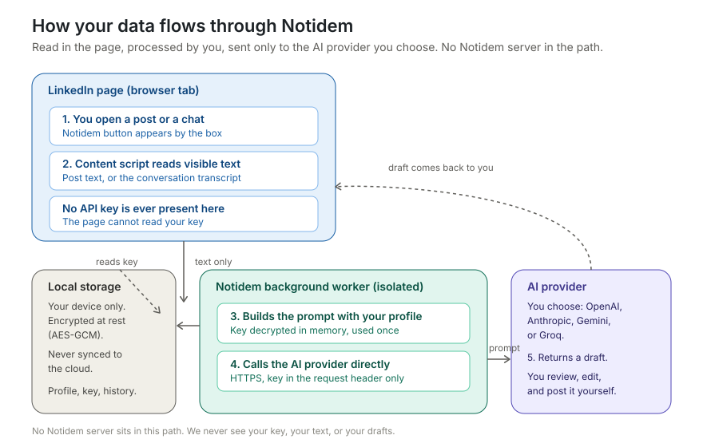

# Notidem

**The opposite of "idem".**

Notidem is an open-source Chrome extension that helps you write genuine, on-brand replies on LinkedIn and X (and a quick draft on any site) with AI — in your own voice, with your own context, always reviewed by you before anything is posted.

Most people reply with "idem", "great post!", or "totally agree". Those replies cost nothing and mean nothing. Notidem helps you do the opposite: thoughtful, specific replies that actually build relationships, drawn from your own profile and the context in front of you.

> Notidem is a drafting assistant, not an automation tool. It never posts, sends, or acts on your behalf. You read every draft, edit it, and send it yourself.

**Version 2.0** brings a LinkedIn-style redesign (with dark mode), X / Twitter support, richer context (files and links), a voice editor, and a Quick draft that works on any website.

---

## Demo

[](https://www.youtube.com/watch?v=DzhSNTzGL8o)

*2-minute walkthrough — from install to first reply.*

---

## What it does

- **Comments and replies in the page.** On a supported network, click the Notidem button by the comment box or composer, pick a goal (add an insight, share an experience, ask a question, agree and build on it, or respectfully disagree), and get a draft grounded in the post and in your profile. A panel (isolated in a Shadow DOM, following the site's dark theme) lets you copy or insert the draft. `Ctrl/Cmd + Enter` generates.
- **LinkedIn message replies.** In a conversation thread, Notidem reads the visible history and helps you reply in context.
- **Quick draft on any site.** Select text on any page, open the Notidem popup, and generate a draft. The selection is read only when you click, using `activeTab` — no always-on access.
- **Your context.** Add a profile (name, headline, about, expertise, goals), up to 8 context files (PDF, TXT, MD — each toggleable) and portfolio links. Settings shows "What the AI sees": the exact context sent with each request, plus a context-strength meter. Notidem uses it as quiet background; it does not paste it back.
- **Your voice.** Tone presets, a style description, phrases to avoid, an emoji policy and writing samples.
- **Bring your own key.** OpenAI, Anthropic, Gemini (`gemini-2.5-flash`) or Groq. Your key is encrypted on your device and sent only to the provider you choose.
- **History and portability.** Search, filter and export your drafts; export/import your profile (never including keys); clear everything in one click.

### Supported networks

| Network | Status | Notes |
|---|---|---|
| LinkedIn | Live | Comments and message replies |
| X / Twitter | Beta | Replies, with a 280-character counter. The site's DOM changes often |
| Instagram, Facebook, Reddit, YouTube, Threads, Bluesky, TikTok | Coming soon | Vote with "I want this" (popup or settings). Quick draft already works on these sites |

---

## Privacy and security

Security is a first-class concern, and we are honest about what is and isn't possible in a browser extension.

- **The API key never touches the web page.** All network calls and key handling happen in the extension's isolated background worker. No page script — LinkedIn's, X's or anyone else's — can read your key.
- **Encrypted at rest.** Your key is encrypted with AES-GCM (Web Crypto API) before being stored.
- **Local only.** Keys live in `chrome.storage.local` and are never synced to the cloud.
- **Never logged.** The key is never written to the console or any log.
- **Sent only to your chosen provider.** No Notidem server sits between you and the AI. We never see your key, your text, or your drafts.
- **Anonymous usage statistics are off by default** (and disabled entirely in this build). Network votes are the only optional exception. See [`docs/PRIVACY.md`](docs/PRIVACY.md).
- **You can wipe it anytime** with "Forget my keys" or "Clear all data".

**Honest limitation:** no browser extension can fully protect a key against malware already running on your computer — to *use* a key, it must be decrypted in the browser. For maximum safety, use a scoped key with a low spend limit and remove it when you're done.

See the end-to-end data flow:



Full details: [`docs/PRIVACY.md`](docs/PRIVACY.md) · [`docs/SECURITY.md`](docs/SECURITY.md) · [`docs/PERMISSIONS.md`](docs/PERMISSIONS.md)

---

## Compliance

- **LinkedIn, X and other networks.** Notidem keeps a human in the loop at all times. It reads only what is already visible on your screen, drafts text you must review, and never auto-posts, auto-sends, mass-messages, scrapes in bulk, or automates any action. This is deliberately the opposite of the templated, mass-outreach pattern these platforms flag.
- **LGPD / GDPR.** Notidem processes personal data (the text you choose to send to an AI provider) locally and transiently, under your control, for the sole purpose of drafting your reply. There is no Notidem backend collecting or storing this data. The lawful basis is your own consent, exercised each time you click Generate. You may erase all locally stored data at any time. See [`docs/PRIVACY.md`](docs/PRIVACY.md).

---

## Responsible use

Notidem is an assistant, not a bot. Social networks' terms (LinkedIn's and X's included) prohibit automation, bulk scraping, and mass outreach — and so does Notidem, by design.

- **You are always in the loop.** Notidem only drafts. You read, edit, and send every message and comment yourself. There is no auto-post, no auto-send, no queue, and no "reply to all".
- **It reads only what is already on your screen,** and only when you click Generate. It does not crawl profiles, harvest connections, or collect anyone else's data.
- **No rate-limit evasion.** Notidem does not simulate typing, randomize timing, or take any action designed to disguise automated behavior, because it performs no automated behavior.
- **Use it at a human pace.** Treat it like a writing aid (a spell-checker or a "rewrite" helper), not a growth tool. Quality replies, not volume.
- **Independent and unofficial.** Notidem is not affiliated with, endorsed by, or connected to LinkedIn, X or any other network, and does not use their trademarks to imply otherwise.

"LinkedIn", "X" and other names are trademarks of their respective owners. Use of any third-party platform is subject to that platform's own terms; you are responsible for your own use. This project is provided as-is, without warranty (see [`LICENSE`](LICENSE)).

---

## Install

Notidem is pending review on the Chrome Web Store. Until then, you can install the packaged build directly:

1. Download the latest `notidem-vX.Y.Z.zip` from [Releases](https://github.com/paulpessoa/notidem/releases) (or `docs/notidem-v2.0.zip` in this repo).
2. Unzip it.
3. Open `chrome://extensions` in Chrome.
4. Turn on **Developer mode** (top-right).
5. Click **Load unpacked** and select the unzipped folder.
6. Open the extension's **Settings**, add your AI provider key, and fill in your profile and voice.
7. Go to LinkedIn or X, open a post, and click the Notidem button — or select text on any site and use the popup's Quick draft.

A friendlier install page lives at the project site (GitHub Pages) — see [`docs/`](docs/).

---

## How it works

1. A content script (LinkedIn or X adapter) detects the comment box or composer by its stable structure, not a single fragile class name, and adds a Notidem button.
2. When you click Generate, it reads the visible post text or conversation transcript. (Quick draft instead reads your current selection, only on click.)
3. It sends that to the background worker, which builds a prompt from your profile, context, voice, goal and the network's rules (e.g. 280 characters on X).
4. The background worker calls your chosen AI provider directly over HTTPS.
5. The draft comes back in the panel. You review it, edit it, and copy or insert it. Nothing is posted automatically.

Inserting uses a synthetic paste event so text goes through the site's own editor model — it never writes into the editor's DOM directly, which would corrupt it.

---

## Build and test

```bash
bash scripts/build.sh          # -> dist/notidem-v2.0.0.zip and docs/notidem-v2.0.zip
node scripts/smoke-test.mjs    # headless Chromium smoke tests (needs playwright)
```

The smoke test needs `playwright`; if it is installed globally, link it: `ln -s "$(npm root -g)" scripts/node_modules`. Selectors are tested against fixtures; always do a manual check on the real, logged-in sites before releasing (see [`docs/RELEASE-v2.md`](docs/RELEASE-v2.md)).

---

## Roadmap

- **In-page button for the most-voted networks** — votes decide what comes next.
- **Per-context profiles** — different voices for when you're a candidate, a recruiter, in sales, or networking.
- **Optional hosted AI** — an opt-in credits model where the key lives on a server and never in the browser. Bring-your-own-key stays free and open forever.

See [`docs/ROADMAP.md`](docs/ROADMAP.md).

---

## Tech

Manifest V3, vanilla JavaScript (build only packages a zip), Web Crypto API for at-rest encryption, strict Content Security Policy, and a small permission set: `storage`, `activeTab`, `scripting`, the four AI provider hosts, and content scripts on LinkedIn and X only. Package is about 448 KB. The full source is here for you to audit. See [`docs/PERMISSIONS.md`](docs/PERMISSIONS.md).

More docs: [`docs/ANALYTICS.md`](docs/ANALYTICS.md) · [`docs/STORE-LISTING.md`](docs/STORE-LISTING.md) · [`docs/RELEASE-v2.md`](docs/RELEASE-v2.md)

---

## Contributing

Issues and pull requests are welcome. If you find a security concern, please read [`docs/SECURITY.md`](docs/SECURITY.md) first.

## License

MIT — see [`LICENSE`](LICENSE).
